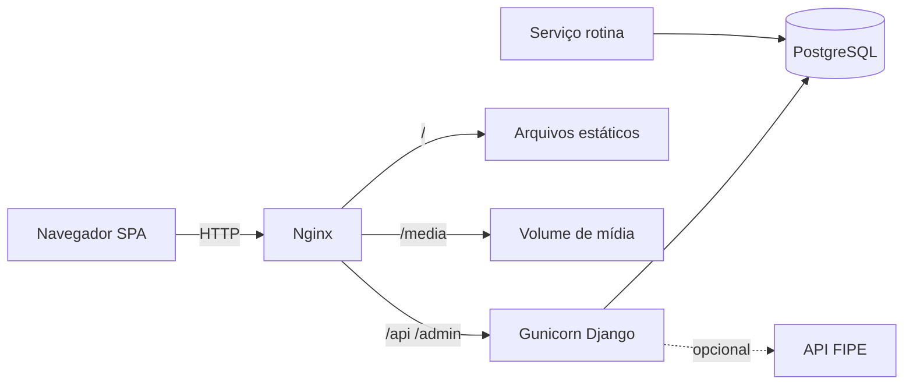

# FleetOps

Aplicação web para gestão de frota corporativa: reserva de veículos, aprovação administrativa, check-in/check-out com vistoria fotográfica, controle de CNH e termo de responsabilidade, relatórios e trilha de auditoria.

## Problema

Empresas que compartilham veículos entre setores precisam de um fluxo claro de solicitação, autorização, retirada e devolução — com histórico auditável e documentos do condutor sob controle. O FleetOps concentra esse processo em uma única aplicação web responsiva.

## Principais funcionalidades

- Autenticação por matrícula e senha (JWT), com primeiro acesso e recuperação assistida por administrador
- Cadastro de veículos, galeria de fotos e consulta auxiliar FIPE (opcional)
- Reservas por horário ou turno, com aprovação/negação justificada
- Check-in e check-out com vistoria fotográfica e quilometragem
- CNH e termo de responsabilidade com fluxo de aprovação
- Catálogo administrativo de **setores** (vínculo de usuários; desativação condicionada)
- Relatórios exportáveis e painel de auditoria com integridade encadeada
- Rotina operacional (cancelamentos automáticos e alertas)

## Tecnologias

| Camada | Stack |
|---|---|
| Frontend | React 18, Vite 5, React Router |
| Backend | Django 5.2, Django REST Framework, SimpleJWT |
| Banco | PostgreSQL 16 |
| Entrega | Docker Compose, Nginx, Gunicorn |

## Arquitetura



## Estrutura do repositório

```
fleetops-public/
├── BACKEND/           # API Django
├── SISTEMA-FINAL/     # SPA React
├── nginx/             # Configuração do proxy
├── docs/              # Documentação detalhada
├── compose.yaml       # Ambiente Docker
├── .env.example       # Modelo de variáveis
└── README-DOCKER.md   # Operação Docker em profundidade
```

## Pré-requisitos

- Docker Engine e Docker Compose v2
- Ou, para desenvolvimento local: Python 3.12+, Node.js 20+, PostgreSQL 16

## Configuração

```bash
cp .env.example .env
# Edite: SECRET_KEY, AUDITORIA_CHAVE_INTEGRIDADE, DB_PASSWORD,
#        ALLOWED_HOSTS, CSRF_TRUSTED_ORIGINS, CORS_ALLOWED_ORIGINS, HTTP_PORT
```

Gere segredos fortes:

```bash
python3 -c "import secrets; print(secrets.token_urlsafe(50))"
```

Não versione o arquivo `.env`.

## Inicialização com Docker Compose

```bash
docker compose up -d --build
```

Serviços: `db`, `backend`, `rotina`, `web`. Acesse `http://localhost:${HTTP_PORT:-80}/`.

**Não** use `docker compose down -v` se quiser preservar banco e mídia.

### Primeiro administrador

O sistema inicia **sem usuários**. Crie o administrador inicial manualmente:

```bash
docker compose exec backend python manage.py criar_admin_inicial \
  --matricula 000001 \
  --nome "Administrador" \
  --password 'SENHA_FORTE_AQUI'
```

Alternativa: `createsuperuser` interativo do Django.

Depois disso, cadastre setores, usuários e veículos pela própria interface.

## Desenvolvimento local

```bash
# Backend
cd BACKEND
python3 -m venv .venv && . .venv/bin/activate
pip install -r requirements.txt
cp ../.env.example .env   # ajuste DB_* para o PostgreSQL local
python manage.py migrate
python manage.py criar_admin_inicial --matricula 000001 --nome Admin --password 'SENHA_FORTE'
python manage.py runserver 0.0.0.0:8000
```

```bash
# Frontend
cd SISTEMA-FINAL
npm ci
npm run dev    # http://localhost:5173
```

## Testes

```bash
# Backend (banco isolado)
cd BACKEND && . .venv/bin/activate
python manage.py test --settings=config.test_settings

# Frontend
cd SISTEMA-FINAL && npm test && npm run build
```

## Segurança (resumo)

- Defina `DEBUG=False` e segredos próprios em qualquer ambiente compartilhado
- JWT no frontend (armazenamento em memória/local conforme implementação atual) — trate a rede como não confiável
- Uploads em `/media/` passam pelo Django: exigem JWT ou link assinado de curta duração (CNH, termos, vistorias e fotos de veículos)
- Recuperação de senha usa códigos de uso único aprovados por administrador (sem e-mail automático por padrão)
- Este repositório é adequado a **demonstração e avaliação técnica**; exposição pública na internet exige hardening adicional (TLS, backup, monitoramento, política de mídia)

Detalhes: [docs/seguranca/checklist.md](docs/seguranca/checklist.md).

## Documentação

Índice completo em [docs/README.md](docs/README.md).

## Limitações conhecidas

- E-mail operacional desligado por padrão (`FROTA_EMAIL_ENABLED`)
- Sem aplicativo nativo; a vistoria é pensada para o navegador no celular
- Sem telemetria GPS obrigatória nem integração ERP/faturamento
- Consulta FIPE depende de serviço externo (falha → HTTP 503; cadastro manual permanece possível)

## Licença

Copyright © 2026 Humberto Gabriel Bezerra de Oliveira. Todos os direitos reservados.

Este projeto está disponível **exclusivamente para avaliação e estudo pessoal**, conforme o arquivo [LICENSE](LICENSE).

- É permitido visualizar, baixar e executar o sistema em ambiente de estudo/avaliação.
- Não é autorizado uso comercial, exploração econômica, modificação, redistribuição, sublicenciamento ou venda.
- A publicação no GitHub não transfere a propriedade do código nem concede direitos além dos expressamente previstos na licença.

Qualquer outra autorização deve ser concedida expressamente pelo titular.
